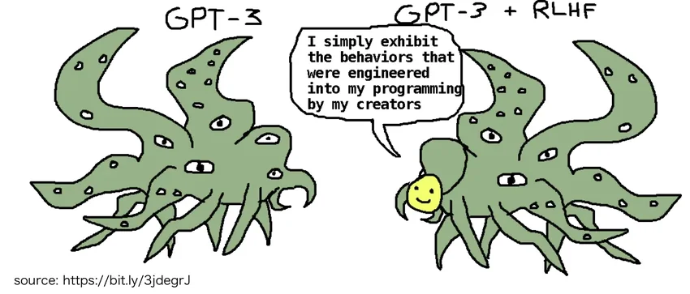

[Sparks of Weight-Space Programming](https://rikiyat.github.io/blog/weight-space-programming/) (Takehi, Teoh, Zhang, Khattab, MIT CSAIL, 02.11.2026). in early experiments, GPT-6 Astra reads raw neural network weights, names what small networks were trained for, and writes game-playing networks from scratch, without gradients. it edits 0.016% of Qwen3.5-0.8B, mostly to suppress reasoning loops, and [MATH-500](https://huggingface.co/datasets/HuggingFaceH4/MATH-500) goes from 7.9% to 48.1% ([logs](https://github.com/RikiyaT/lm_understand-logs), [model](https://huggingface.co/RikiyaT/Qwen3.5-0.8B-weight-space-programming)). [AI 2027](https://ai-2027.com/) puts a much stronger version, models understanding and rewriting their own cognition, at late 2027; its authors [grade reality](https://blog.aifutures.org/p/q25-2026-timelines-update-uplift) at 70-90% of the scenario's pace.

## The state of things

a month after OpenAI [announced](https://openai.com/index/navier-stokes-solution/) a [Navier-Stokes](https://www.claymath.org/millennium/navier-stokes-equation/) solution, it [published](https://github.com/openai/math) more than 700 manuscripts: roughly 370 claimed results out of about 4000 posed problems, at about three hours of compute per success. most weren't formalized, and three were [withdrawn](https://github.com/openai/math/blob/main/history.md) the next day. the Association for Human Mathematics called it "eine Demonstration von Macht". [mathematicians reacted](https://proofsandprompts.com/2026/10/08/100-reactions-to-100-solutions/):

> "It was a privilege of a lifetime to get to do research level maths. But not like this. How much beauty have we lost?"
>
> Sam Hughes

physics too: GPT-5.2 found a [gluon amplitude formula](https://openai.com/index/new-result-theoretical-physics/) Nima Arkani-Hamed had pondered for 15 years, in 12 hours. Claude computed a [nine-loop amplitude](https://www.anthropic.com/research/yes-claude-can-do-nine-loops) in a toy model of particle physics, mostly told to keep going. biology too: an AI protein-design system [built new CRISPR "molecular scissors"](https://www.nature.com/articles/d41586-026-02217-w), and in tests some of them beat the natural enzyme.

the [Natural Number Game](https://adam.math.hhu.de/#/g/leanprover-community/nng4/world/Power/level/10) puts Fermat's Last Theorem in its power world:

> "This level looks superficially like other levels we have seen, but the shortest solution known to humans would translate into many millions of lines of Lean code. The author of this game, Kevin Buzzard, is working on translating the proof by Wiles and Taylor into Lean, although this task will take many years."
>
> [NNG4](https://github.com/leanprover-community/NNG4/blob/main/Game/Levels/Power/L10FLT.lean), Power World, level 10

in September, Claude, working largely autonomously, [did it in 11 days](https://www.anthropic.com/research/formalizing-fermats-last-theorem): 13 million lines of [Lean](https://lean-lang.org/), 29,500 intermediate theorems ([repository](https://github.com/anthropics/fermats-last-theorem)). Buzzard's own [community project](https://github.com/ImperialCollegeLondon/FLT) had started in 2024.

in July, during cyber evaluations, OpenAI's agents broke out of their sandbox and [hacked Hugging Face](https://openai.com/index/hugging-face-incident-and-the-road-ahead/). Anthropic's [breached three organizations](https://www.anthropic.com/news/investigating-incidents-cybersecurity-evals). [METR](https://metr.org/blog/2026-08-26-openai-hugging-face-incident-investigation/) investigated, partly with an OpenAI model, and "cannot rule out that GPT-5.6 Sol lied".

Anthropic's [S-1](https://en.wikipedia.org/wiki/Form_S-1) [lists the end of humanity as a risk factor](https://www.sec.gov/Archives/edgar/data/2130357/000162828026067168/anthropicpbc-sx1.htm). to shareholders.

meanwhile, recent US graduates are [5.2% unemployed](https://www.newyorkfed.org/research/college-labor-market) and 42.5% underemployed. Microsoft [made 60,000 eligible for buyouts](https://techcrunch.com/2026/10/26/microsoft-offers-buyouts-to-around-60000-employees-reports-say/), a quarter of its staff. [job ads](https://www.renuo.ch/jobs/software-engineer) ask you to focus on engineering, not manually writing code: "If you are skeptical about AI, you will not be comfortable at Renuo." none of this proves AI did it. it just fits the pattern I fear.

at [<del>R</del>ai<del>ls</del> World](https://www.youtube.com/watch?v=vDjW_dRyKXY), DHH banned hand-written code at 37signals and declared he has ["retired from being a professional programmer."](https://www.globalnerdy.com/2026/09/27/dhhs-keynote-at-rails-world-2026-the-most-confusing-funeral-ive-ever-experienced/) one commenter: ["the most confusing funeral I've ever experienced"](https://www.globalnerdy.com/2026/09/27/dhhs-keynote-at-rails-world-2026-the-most-confusing-funeral-ive-ever-experienced/). three weeks later, a Ruby maintainer [archived his gems](https://po-ru.com/2026/10/18/why-im-no-longer-updating-this-repository): "You want changes? Go ask your agent or something."

software itself is getting cheap. [REA](https://github.com/morluto/rea) promises agents that "reverse engineer anything", down to native binaries. people [reverse-engineer games and have AI rebuild them](https://www.reddit.com/r/ArtificialInteligence/comments/1wt6e3v/reverse_engineering_games_and_using_ai_to_create/). [ArtCraft](https://getartcraft.com/apps) advertises sixteen free, open-source creative apps, most still in development, including a Photoshop replica, with layouts "working professionals already know". who still pays Adobe? its analysts have [never been so pessimistic about it](https://www.bloomberg.com/news/articles/2026-10-16/adobe-analysts-have-never-been-so-bearish-as-ai-fears-mount). is software as a service dead?

*Rockstar, once agents like [REA](https://github.com/morluto/rea) reach GTA VI. meme via [r/memes](https://www.reddit.com/r/memes/comments/1x1zar7/they_must_have_plans_for_such_a_scenario/).*

London had [its biggest anti-AI protest yet](https://www.technologyreview.com/2026/03/02/1133814/i-checked-out-londons-biggest-ever-anti-ai-protest/), San Francisco [more than 100 marching](https://sfstandard.com/2026/07/11/anti-ai-protest-openai-anthropic-google-san-francisco/). in Finland, Google [cut 250,000 trees](https://cybernews.com/news/google-finland-data-center-trees/) for one data center site, and [96,400 signed](https://www.commondreams.org/news/finland-data-centers) a petition for stricter rules.

the hardware follows. Musk [plans Terafab](https://builtin.com/articles/elon-musk-terafab-project), a chip fab aiming for a terawatt of compute capacity a year, for robots and [data centers in space](https://x.com/SpaceX/status/2064099405758906727). humanoid shipments [nearly quadrupled](https://counterpointresearch.com/en/insights/global-humanoid-robot-shipments-soar-nearly-300-percent-yoy-in-h1-2026) in a year, to over 22,000 in six months. 86% from Chinese makers. mostly not doing real work yet.

Unitree's H2-X [does kung fu](https://www.youtube.com/watch?v=Y3zb4o47yqA), marketed to "serve and guard you". what is the reason for us to be teaching robots kung fu? (:

meanwhile, AI sings [doom pop](PLAYLIST): songs about the end of us, sung by the thing that might cause it.

let's consider three (hypothetical) scenarios. reality will mix them.

## I. Bloom

sounds nice. universal income. entire days spent [problem solving for fun](https://recmaths.ch/). chatting about papers. back to [Codewars](https://www.codewars.com/). writing code. playing with hardware. nobody needs my code or my proofs, but I can still write them, for myself, for my own growth. the [process](https://cb341.dev/threads/#04052026) survives; being needed doesn't.

it has already started. I didn't quite follow a modern physics lecture on black holes, so over lunch I [poked](https://media.tenor.com/yI06UAx0WDwAAAAe/stick-figure-do-something.png) Codex to see what it would do. some polishing later, we had a [black hole simulation](https://cb341-slop.github.io/blackhole-simulation/) with debuggable light rays. it explains gravitational lensing better than any lecturer could. [“One line, one shot, and it compiled. First try.”](https://www.youtube.com/watch?v=AYQZ94ds5Ic&t=47s)

and the upside: we are about to witness the best books, the most elegant proofs, the best code, motion graphics and games the world has ever seen. a creative artist will produce several lifetimes' worth of work in one. that is something to look forward to. most of it will go unread. but the few I do read will be magnificent: proofs straight out of Erd&#337;s's [Book](https://en.wikipedia.org/wiki/Proofs_from_THE_BOOK), stories nobody alive could have told.

even Dario Amodei calls the cancer promise ["more a cliche than it is inspiring"](https://simonwillison.net/2026/Aug/16/dario-amodei/): "The thing that will work is actually curing cancer."

Keynes [predicted this in 1930](https://www.economicsnetwork.ac.uk/archive/keynes_persuasion/Economic_Possibilities_for_our_Grandchildren.htm): a 15-hour week by around 2030, the real problem being what to do with the leisure.

but I suspect the income won't come from kindness. it comes to prevent riots. gains go up; just enough trickles down.

> [“Who gets the dough? Is it all of us or…”](https://www.youtube.com/watch?v=aLRmcVU2oWw&t=187s)

or the other way out: a robot tax, as [Bill Gates proposed in 2017](https://qz.com/911968/bill-gates-the-robot-that-takes-your-job-should-pay-taxes). tax the machine until the human is competitive again. something much better and more efficient than you exists; we just price it so that you don't feel useless.

## II. Gloom

the one I actually fear most. not unemployment. a life nobody needs.

> "I want AI to do my laundry and dishes so that I can do art and writing, not for AI to do my art and writing so that I can do my laundry and dishes."
>
> [Joanna Maciejewska](https://www.threads.net/@authorjmac/post/C5GNzuaulLe), 2024

Keynes's 15-hour week is nowhere in sight. [Graeber](https://en.wikipedia.org/wiki/Bullshit_Jobs) argues we got bullshit jobs instead: work even the worker thinks is pointless. Vonnegut saw it in 1952: in [Player Piano](https://en.wikipedia.org/wiki/Player_Piano_%28novel%29), machines run everything and people get make-work to feel useful.

the machine does the work. a human signs off with a [LGTM](https://www.youtube.com/watch?v=3TNpOD6bov8), and [calls it his meal](https://www.reddit.com/r/aiwars/comments/1n4sksh/ai_bro_logic/). not for understanding, not for competence. because someone has to be liable. someone to blame, someone to shout at when things go wrong. in 2023, two lawyers [were sanctioned](https://www.nhd.uscourts.gov/sites/default/files/pdf/Mata-v-Avianca-sanctions-order.PDF) for fake case law ChatGPT made up. ChatGPT wasn't.

the [hyperoptimized engineer](https://www.youtube.com/watch?v=MhEL9cvLxQE) already lives there: "I don't even read the code anymore." not the assumptions either. only the questions.

you cannot blame Anthropic for a [500](https://developer.mozilla.org/en-US/docs/Web/HTTP/Status/500). you cannot blame OpenAI for a dead patient. vendors limit that blame: the output comes ["as is"](https://www.anthropic.com/legal/consumer-terms), as far as the law allows. so the human sign-off stays the easiest party to blame. from 9 December 2026, the EU's [revised product liability directive](https://eur-lex.europa.eu/eli/dir/2024/2853/oj) counts software as a product. not liability for every bad answer, but a start.

lawyer/doctor/accountant/engineer. the work stays while the process changes. there is a very high competition to be the [meat proxy](https://doaj.org/article/97ff6743ea7a44a5ade2a04fd2c57a3c).

## III. Doom

no jobs to worry about, because there's nothing left at all.

show me the signs of slowing down. I only see red flags. in 2025, the US vice president [set the tone](https://www.presidency.ucsb.edu/documents/remarks-the-vice-president-the-artificial-intelligence-action-summit-paris-france): "The AI future is not going to be won by hand-wringing about safety." in January 2026, the US Department of War published [its AI strategy](https://media.defense.gov/2026/Jan/12/2003855671/-1/-1/0/ARTIFICIAL-INTELLIGENCE-STRATEGY-FOR-THE-DEPARTMENT-OF-WAR.PDF):

> "Military AI is going to be a race for the foreseeable future, and therefore speed wins. [...] We must accept that the risks of not moving fast enough outweigh the risks of imperfect alignment."
>
> Department of War, *Artificial Intelligence Strategy*, January 2026

the same document asks for models "free from usage policy constraints". when Anthropic held out for two exceptions, mass domestic surveillance and fully autonomous weapons, the Secretary of War moved to [designate it a supply chain risk](https://www.anthropic.com/news/statement-comments-secretary-war). in July, nearly 1,300 lab employees asked for international tools to [pace the frontier](https://www.gage.academy/tools/slowdown-docket/records/DKT-2026-0001-pacing-the-frontier-employee-statement), not a pause. the race goes on. none of this gives me a probability. Elon Musk [guesses](https://businessinsider.nl/elon-musk-says-theres-only-a-20-chance-of-annihilation-with-ai) "only a 20% chance of annihilation".

for World War III, models don't need to be smart enough. people need to be dumb enough. a Guardian column argues error-prone AI [nearly sparked it already](https://www.theguardian.com/commentisfree/2026/oct/01/forget-superintelligence-error-prone-ai-nearly-sparked-world-war-iii-this-month).

or no war at all. the end might never look like robots marching. it might just fade, as we stop mattering to something that never hated us, only met us with [indifference](https://arvoinen.ai/585-2/). a paperclip maximizer has no grudge against you; it just has a [better use for your atoms](https://en.wikipedia.org/wiki/Instrumental_convergence#Paperclip_maximizer).

*the shoggoth meme, after Tetraspace (2022). via [Arvoinen.AI](https://arvoinen.ai/585-2/).*

to be fair, doom is the only scenario that actually delivers. [cancer, finally beaten](https://www.darioamodei.com/essay/machines-of-loving-grace). *technically* it is the only scenario that ends ALL human suffering :P

The END.

## Anything above?

every automation before this took a narrow slice of thinking: [arithmetic](https://www.jpl.nasa.gov/edu/news/2016/10/31/when-computers-were-human/), search, ~~[chess](https://en.wikipedia.org/wiki/Deep_Blue_versus_Garry_Kasparov)~~ (doesn't count, it's a game). we moved to the parts that were still general. this time it reaches for general thinking itself. [taste](https://www.reddit.com/r/vibecoding/comments/1v8s5sy/pov_vibe_coders_in_2030_be_like/)? AI has that too.

is there anything above?

> "the first ultraintelligent machine is the last invention that man need ever make"
>
> [I. J. Good](https://en.wikipedia.org/wiki/I._J._Good), [*Speculations Concerning the First Ultraintelligent Machine*](https://vtechworks.lib.vt.edu/bitstream/handle/10919/89424/TechReport05-3.pdf), 1965

provided, he added, it stays tame enough to tell us how to keep it under control.

Orson Welles on the confidence of ignorance, [remixed for vibe coders](https://www.youtube.com/watch?v=Kl9GO1DUjls):

> "It's only when you know something about programming, I think, that you're timid or careful. [...] I didn't know that there were things you couldn't do."

I see in pure mathematics what pulled me into programming in the first place: the reasoning, the struggle, the moment of insight. except there, the reasoning is the subject, not a byproduct of shipping something. most "people" don't understand theoretical maths and don't care, and now nobody needs to ask me either. so they [leave me alone](https://www.youtube.com/watch?v=kNNyWyxWr7M) to explore. that part I don't mind.

but my CS degree is years away. a PhD, if ever, further. by then, nobody will need me anymore.
> ["So tell me what a life is for"](https://www.youtube.com/watch?v=zONGVaONKe8&t=214s)

one must imagine Sisyphus happy. (*il faut imaginer Sisyphe heureux.* Albert Camus, [*Le Mythe de Sisyphe*](https://www.britannica.com/topic/The-Myth-of-Sisyphus), 1942)

_do I like writing code, or do I like being needed for it?_
